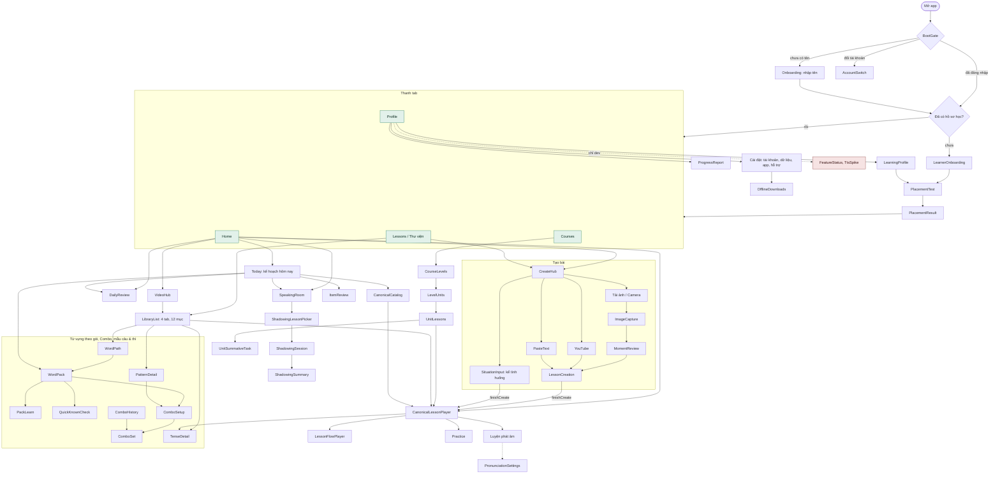

# Bản đồ tính năng đang hoạt động

> Dựng lại từ code, không từ tài liệu cũ. Snapshot: App `main @ 53670ea`,
> Server `main @ 4b04ca1`, cờ tính năng theo `src/core/release/configs/production.ts`
> (28/10/2026). Khi thêm/bỏ màn hình, route hoặc cờ, cập nhật lại file này.

Nguồn chính:

- Màn hình và luồng: `src/app/navigation/AppNavigator.tsx`, `rootStackRoutes.ts`,
  `appNavigationAdapter.ts` (xem thêm [`navigation.md`](./navigation.md)).
- Cờ tính năng: `src/core/release/feature-registry.ts`, `configs/production.ts`.
- API server: các `controller` trong `LingoBites-Server/src/modules/*` và `src/app/controller`.

## 1. Toàn cảnh điều hướng

Chú thích màu: xanh = tab chính, đỏ = chỉ bản dev.

## 2. Các nhóm tính năng đang chạy

### Tài khoản & khởi động

Tạo người dùng theo thiết bị, làm mới phiên, kiểm tra lại server khi app trở
lại foreground (chế độ offline).

- Màn hình: `BootGate`, `Onboarding`, `AccountSwitch`
- API: `POST /v1/users`, `POST /v1/auth/refresh`, `GET /v1/me`, `GET /v1/capabilities`

### Hồ sơ học & xếp lớp

Người học chưa có hồ sơ phải qua onboarding và bài kiểm tra xếp lớp trước khi
vào tab. Có thể làm lại từ Profile.

- Màn hình: `LearnerOnboarding`, `PlacementTest`, `PlacementResult`, `LearningProfile`
- API: `GET|PUT /v1/me/learner-profile`, `GET /v1/placement/test`, `POST /v1/placement/submit`

### Tạo bài từ nội dung riêng

4 nguồn trong `CreateHub`. Tất cả cần server; khi offline các ô vẫn hiện nhưng
bị khoá. Ô Ảnh, Dán văn bản và Kể tình huống theo cờ `imageInput`,
`pasteTextInput`, `situationLearning` (đều bật ở production).

| Nguồn                   | Luồng                                                                                                 |
| ----------------------- | ----------------------------------------------------------------------------------------------------- |
| Ảnh (camera / thư viện) | `ImageCapture` → phân tích ảnh → `MomentReview` → xác nhận → `LessonCreation`                         |
| Dán văn bản             | `PasteText` → `LessonCreation`                                                                        |
| Kể tình huống           | `SituationInput` → tạo bài → mở bài                                                                   |
| YouTube                 | nhập link → `LessonCreation`; ô ẩn khi server tắt switch `youtube` hoặc app chưa liên lạc được server |

- API: `POST /api/v1/images/analyze`, `POST /api/v1/lesson-creations`,
  `POST /api/v1/lesson-creations/:id/confirm`, `POST /api/v1/moments`,
  `GET /api/v1/situations`

### Học bài

Một trình phát bài dùng chung cho mọi nơi mở bài (Home, Thư viện, Giáo trình,
Today). Bài 6 bước mở `LessonFlowPlayer`. Bài tự tạo (văn bản, ảnh chữ,
YouTube) mở chuỗi luyện 4 phần trên máy (nghe và nhắc lại, nghĩa từ, điền từ,
dịch câu) ở màn `Practice`; làm xong mới tính hoàn thành bài, kèm gợi ý "Học
sâu theo 6 bước" với câu chọn sẵn. Bài quá ít nội dung vẫn dùng nút ✓.

- Màn hình: `CanonicalLessonPlayer`, `LessonFlowPlayer`, `Practice`, `CanonicalCatalog`
- API: `GET /api/v1/lessons`, `GET|DELETE /api/v1/lessons/:id`,
  `GET /api/v1/lessons/:id/source-image`, `POST /v1/evaluations/text`,
  `GET /v1/evaluations/:attemptId`

### Giáo trình có cấu trúc

Course → Level → Unit → Lesson, kèm bài tổng kết (summative task) cuối Unit.
Quyền truy cập khoá học theo entitlement.

- Màn hình: `CourseList`, `CourseLevels`, `LevelUnits`, `UnitLessons`, `UnitSummativeTask`
- API: `GET /v1/courses`, `GET /v1/courses/:slug/levels`, `GET /v1/levels/:id/units`,
  `GET /v1/units/:id/lessons`, `GET /v1/units/:id/summative-task`,
  `GET /v1/me/course-entitlements`

### Luyện tập & ôn tập

`Today` gom việc cần làm trong ngày. Ôn tập lặp lại ngắt quãng chạy trên dữ
liệu cục bộ, sự kiện ôn được gửi lên server. Phòng nói có luyện shadowing.

- Màn hình: `Today`, `DailyReview`, `ItemReview`, `SpeakingRoom`,
  `ShadowingLessonPicker`, `ShadowingSession`, `ShadowingSummary`
- API: `POST /v1/review-events`

### Thư viện (tab Lessons)

4 tab, 12 mục (`src/features/lesson/library/logic/librarySections.ts`):

| Tab         | Mục                                                                       |
| ----------- | ------------------------------------------------------------------------- |
| Khám phá    | Học theo gói, Kho mẫu câu, Bản đồ thì, Bài học công khai, Video công khai |
| Đã lưu      | Từ vựng của tôi, Ngữ pháp của tôi, Bộ câu đã học, Câu đã lưu              |
| Bài tôi tạo | Bài học của tôi, Video của tôi                                            |
| Khoảnh khắc | Khoảnh khắc                                                               |

`VideoHub` trên Home mở thẳng vào mục video.

- Màn hình: `LessonsList`, `LibraryList`, `VideoHub`
- API: `GET /api/v1/moments/library`, `GET /api/v1/lessons`

### Từ vựng theo gói & Combo

Gói từ (Word Path) để tải và học; trong gói có học từng từ, kiểm tra nhanh từ
đã biết và tạo Combo (bộ câu ghép từ của gói với một mẫu câu / thì). Today có
thể gợi ý một gói (`word_pack`).

- Màn hình: `WordPath`, `WordPack`, `PackLearn`, `QuickKnownCheck`, `ComboSetup`,
  `ComboSet`, `ComboHistory`
- API: `GET /v1/word-path`, `GET /v1/word-packs/:id`, `POST /v1/word-packs/:id/learn`,
  `GET /v1/combo/options`, `GET /v1/combo/situations`, `GET|POST /v1/combo/sets`,
  `GET /v1/combo/sets/:id`, `POST /v1/combo/sets/:id/more`,
  `POST /v1/combo/sentences/:id/reports`

### Mẫu câu & thì

Kho mẫu câu và bản đồ thì trong Thư viện; từ một mẫu câu có thể tạo Combo. Thẻ
thì trong bài học mở `TenseDetail`.

- Màn hình: `PatternDetail`, `TenseDetail` (danh sách nằm trong `LibraryList`)
- API: `GET /v1/library/patterns`, `GET /v1/library/tenses`

### Phát âm

Đọc to câu hoặc từ (trong bài, thẻ từ của bài, gói từ, thẻ ôn) và nhận điểm từ
Azure. Bản ghi tải lên `/v1/recordings`, server chấm bằng worker nền. Người học
đồng ý ghi âm một lần; tắt / bật lại ở `PronunciationSettings`. Không mở cho
người học nhỏ tuổi (A11).

- Màn hình: sheet `PronunciationPracticeSheet` trong trình phát bài, `PronunciationSettings`
- API: `POST /v1/recordings`, `PUT /v1/recordings/:id/content`,
  `GET /v1/pronunciation/attempts/:recordingId`
- Điều kiện ở server: `PRONUNCIATION_ENABLED=true`, `AZURE_SPEECH_KEY` /
  `AZURE_SPEECH_REGION`, bucket `RECORDINGS_GCS_BUCKET`, switch `pronunciation`

### Hồ sơ, cài đặt & offline

Mục tiêu tuần, nhắc học, báo cáo tiến độ, cài đặt tài khoản / dữ liệu / giao
diện (7 theme màu), tải bài để học offline. Dữ liệu cục bộ đồng bộ đẩy lên server.

- Màn hình: `ProfileMain`, `ProgressReport`, `AccountSettings`, `DataSettings`,
  `OfflineDownloads`, `AppSettings`, `SupportAbout`, `PrivacyNote`
- API: `POST /v1/sync/push`, `PATCH /v1/me`

## 3. Chưa bật hoặc chỉ có một phần

| Mục                                           | Trạng thái | Ghi chú                                                                            |
| --------------------------------------------- | ---------- | ---------------------------------------------------------------------------------- |
| `FeatureStatus`, `TtsSpike`                   | Chỉ dev    | Chỉ đăng ký khi `__DEV__`.                                                         |
| OCR riêng & pipeline phân tích AI bất đồng bộ | Đã gỡ      | Gỡ khỏi server ở commit `d8e9942`. Luồng ảnh hiện đi qua `/api/v1/images/analyze`. |

## 3b. Switch phía server

Admin bật / tắt không cần deploy (`server.features`, `today.features`); app đọc
qua `GET /v1/capabilities`. Một tính năng chỉ chạy khi server sẵn sàng (env,
key, ffmpeg) **và** admin bật.

| Switch              | Ảnh hưởng ở app                                         |
| ------------------- | ------------------------------------------------------- |
| `youtube`           | Ô YouTube trong `CreateHub`                             |
| `compose`           | "Học sâu theo 6 bước" từ câu chọn trong bài             |
| `moments.describe`  | Ý định "Tả" trong Kể tình huống                         |
| `evaluation.speech` | Chấm câu trả lời nói của bài tập nói                    |
| `pronunciation`     | Luyện phát âm                                           |
| `today.features`    | Từng loại việc trong kế hoạch Today (ôn tập, gói từ, …) |

## 4. Phía quản trị (admin-web, repo Server)

Không thuộc app người học, nhưng là nơi sinh nội dung cho Giáo trình và Thư
viện công khai: quản lý Course/Level/Unit/Lesson, khối bài và hoạt động, item
từ vựng/mẫu câu, soạn bài bằng AI (compose) và hạn mức, quản lý prompt AI,
transcript YouTube, media, người dùng, chấm điểm và báo cáo lỗi item. Tất cả
nằm dưới `/v1/admin/*`.
