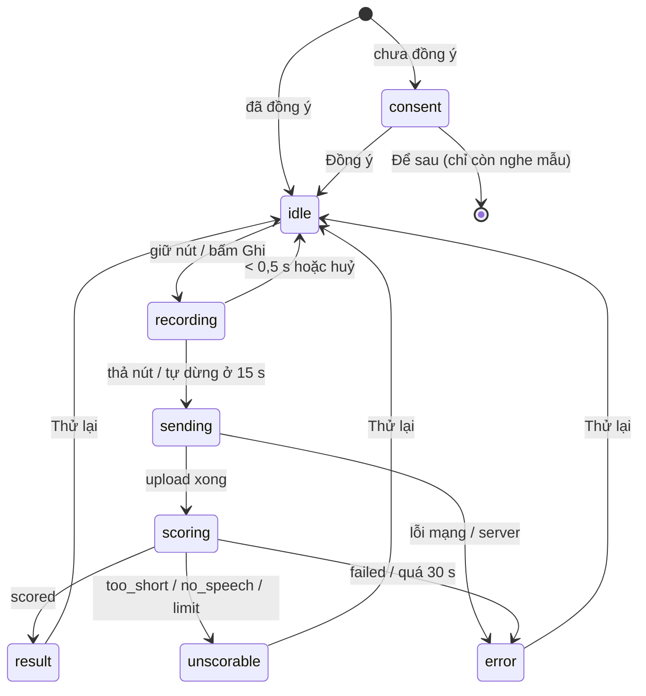

# Bước 3: App luyện phát âm

> Trạng thái: **KẾ HOẠCH, CHỜ DUYỆT**. Ngày: 2026-10-18.
> Repo: `LingoBites-App`. Không đổi server.
> Đi trước: `2026-10-12-pronunciation-architecture.md` (kiến trúc), `2026-10-18-pronunciation-step2-server-plan.md` (server, đã xong).

## 0. Server đã có (bước 2)

- `GET /v1/capabilities` → `capabilities.pronunciation.enabled` (cờ bật và có ffmpeg). Không cần đăng nhập, không biết tài khoản trẻ em.
- `POST /v1/recordings` với `mode: "pronunciation"`, `item_id`, `duration_ms` ≤ 15 000, `mime_type`, `byte_size`, `sha256`. 403 `PRONUNCIATION_DISABLED` (cờ tắt / trẻ em), 404 `PRONUNCIATION_ITEM_NOT_FOUND`.
- `PUT /v1/recordings/:id/content` như các bản ghi khác.
- `GET /v1/pronunciation/attempts/:recordingId` → `status: pending | scored | unscorable | failed`, `unscorable_reason: too_short | no_speech | limit | target_gone`, `scores` (0–100: `pron`, `accuracy`, `fluency`, `completeness`, `prosody`), `words[]` (`text` null với từ thừa, `accuracy`, `error: none | mispronunciation | omission | insertion`, `phonemes[] { ipa, accuracy }`).

## 1. Cần chốt (plan dùng mặc định dưới đây nếu không có ý kiến khác)

| # | Câu hỏi | Mặc định trong plan | Lý do |
|---|---|---|---|
| 1 | Màn luyện là màn riêng hay bảng trượt (modal sheet) trên màn bài học | **Bảng trượt** mở từ từng item trong mục Phát âm | Không phải thêm route vào navigation, người học không rời bài học. Đóng là quay lại đúng chỗ. |
| 2 | Xin đồng ý riêng hay dùng chung đồng ý "Chấm bài nói bằng máy" | **Riêng** (`speaking.pronunciation_consent`) | Bên xử lý khác (Microsoft Azure, không phải OpenAI), mục đích khác, cách giữ audio khác (xoá ngay, không phải 30 ngày). Gộp sẽ làm lời xin đồng ý cũ sai. |
| 3 | Ngưỡng màu | ≥ 80 xanh, 60–79 vàng, < 60 đỏ, từ bị bỏ (`omission`) xám gạch ngang | Hằng số trong một file, chỉnh ở bước 4 theo dữ liệu. |
| 4 | Nghe lại giọng mình | Có. File trên máy giữ tới khi đóng bảng rồi xoá | Đối chiếu giọng mình với mẫu là cách học chính. Server đã xoá bản của nó. |
| 5 | Không có mạng | Báo "Cần kết nối mạng để chấm", **không** xếp hàng gửi sau | Người học đang chờ kết quả ngay; gửi sau thì mất ngữ cảnh và tốn chỗ máy. |
| 6 | Thông báo riêng tư ngoài app (store, website) | Bạn cập nhật, plan chỉ soạn nội dung | Trong repo không có trang chính sách riêng tư. |

## 2. Trải nghiệm

- **Mục Phát âm** (`LessonPronunciationSection`): mỗi item có thêm nút "Luyện phát âm" khi: server bật (`capabilities`), người học không phải trẻ em (`profile.ageGroup`), thiết bị có micro. Không đủ điều kiện thì ẩn nút, phần nghe mẫu và bài "Nghe và chọn" giữ nguyên.
- **Bảng luyện**:
  - Trên cùng: câu mẫu (`item.text`), IPA nếu có, nút loa nghe mẫu (`useSpeak` sẵn có).
  - Lần đầu: hộp xin đồng ý (giống `EvaluationConsentPrompt`), nêu rõ gửi tới Microsoft Azure, xoá ngay sau khi chấm.
  - Nút ghi lớn: bấm để bắt đầu, bấm lần nữa để dừng, tự dừng ở 15 s, có đồng hồ đếm.
  - Đang gửi / đang chấm: vòng xoay và chữ "Đang chấm…".
  - Kết quả:
    - Điểm tổng (`pron`) lớn, kèm một câu nhận xét theo ngưỡng.
    - Câu mẫu tô màu từng từ. Bấm một từ thì hiện các âm IPA của từ đó với điểm, âm dưới 60 tô đỏ.
    - Từ bị bỏ: xám, gạch ngang, ghi "chưa đọc".
    - Có từ thừa: một dòng "Bạn đọc thêm N từ" (server không gửi chữ).
    - Nút: Nghe mẫu, Nghe lại giọng tôi, Thử lại.
  - `unscorable`: lý do bằng tiếng Việt ("Ghi âm quá ngắn", "Chưa nghe thấy tiếng, hãy nói to và gần micro hơn", "Hôm nay bạn đã dùng hết lượt chấm, quay lại ngày mai").
  - Lỗi: "Không chấm được lúc này" + Thử lại.

## 3. Chia PR

Mỗi PR chạy được, test xanh, nút luyện vẫn ẩn cho tới PR 3.3.

### PR 3.1: Dữ liệu, đồng ý, client

| File | Việc |
|---|---|
| `src/core/schemas/pronunciation.ts` (mới) | Zod cho response `GET /v1/pronunciation/attempts/:id` và `capabilities.pronunciation`. |
| `src/features/speaking/logic/upload/recordingConsent.ts` | Khoá `speaking.pronunciation_consent` (+ `_asked_at`), `readPronunciationConsent`, `setPronunciationConsent`, `shouldAskPronunciationConsent` (hỏi lại sau 7 ngày nếu từ chối, như chấm bài nói). |
| `src/features/speaking/logic/api/recordingClient.ts` | Nhận request `mode: "pronunciation"`; `consent: 'pronunciation'` kiểm tra đồng ý phát âm ngay trước khi gửi (`beforeSend`). 403/404 là lỗi hẳn, không thử lại. |
| `src/features/speaking/logic/recordingService.ts` | `startRecording` nhận mode `pronunciation`, dùng `LESSON_TASK_AUDIO_SET` (AAC 16 kHz mono 32 kbps: đủ cho Azure, file nhỏ). |
| `src/features/speaking/index.ts` | Export các hàm trên cho feature mới (qua barrel, đúng quy tắc boundary). |
| `src/features/pronunciation/logic/pronunciationClient.ts` (mới) | `fetchPronunciationEnabled()` (đọc `/v1/capabilities`, nhớ trong phiên), `submitReading()` (tạo + upload qua client của speaking), `fetchReading(recordingId)` → `pending | ready | not_found | offline`. |
| `src/features/lesson/player/logic/lessonHubContent.ts` | `LessonPronunciationEntry` thêm `itemId` (đã có trong snapshot: `entry.item.id`). |

Test: schema đọc đúng response mẫu (lấy từ test server), client với `fetch` giả (201, 403, 404, 5xx, mất mạng), consent hỏi lại sau 7 ngày, `beforeSend` chặn khi rút lại đồng ý.

### PR 3.2: Logic luyện (hook)

| File | Việc |
|---|---|
| `src/features/pronunciation/logic/usePronunciationPractice.ts` (mới) | Máy trạng thái ở mục 2. Ghi (tối đa 15 s), tính sha256 + kích thước (dùng `readRecordingFileForUpload` sẵn có), gửi, hỏi kết quả mỗi 1 s rồi giãn dần, dừng ở 30 s. Huỷ khi đóng bảng hoặc app xuống nền. Xoá file khi đóng. |
| `src/features/pronunciation/logic/scoreBands.ts` (mới) | Ngưỡng màu, câu nhận xét theo điểm, map lý do `unscorable` sang khoá i18n. |

Test (Jest, recorder và client giả): đi đủ các nhánh của sơ đồ trạng thái; dừng hỏi khi đóng; file bị xoá khi đóng, kể cả khi đang gửi; bấm "Thử lại" bắt đầu bản ghi mới (id mới).

### PR 3.3: Giao diện

| File | Việc |
|---|---|
| `src/features/pronunciation/components/PronunciationPracticeSheet.tsx` (mới) | Bảng trượt ở mục 2. |
| `src/features/pronunciation/components/PronunciationResult.tsx` (mới) | Điểm tổng, từ tô màu, chi tiết âm khi bấm từ. Màu lấy từ theme (sáng/tối), không chỉ dựa vào màu: từ sai có thêm gạch chân, có `accessibilityLabel` đọc điểm. |
| `src/features/pronunciation/components/PronunciationConsentPrompt.tsx` (mới) | Hộp xin đồng ý (mục 4). |
| `src/features/pronunciation/index.ts` (mới) | Barrel: sheet, hook kiểm tra đủ điều kiện. |
| `src/features/lesson/player/components/LessonPronunciationSection.tsx` | Nút "Luyện phát âm" mỗi item, mở bảng. Sửa comment "Nothing here records the learner". |
| `src/features/speaking/components/PronunciationSettingsRow.tsx` (mới) + `src/features/profile/screens/DataSettingsScreen.tsx` | Công tắc "Chấm phát âm bằng máy" cạnh "Chấm bài nói", để bật/tắt lại đồng ý. |
| `src/core/i18n/vi.json`, `en.json` | Khoá `pronunciation.*`. |

Test (React Native Testing Library): nút ẩn khi cờ tắt / trẻ em / chưa có micro; hiện hộp đồng ý lần đầu; từ chối thì không ghi được; kết quả tô đúng màu theo mẫu; từ bị bỏ và từ thừa hiện đúng; các thông báo `unscorable`; snapshot sáng/tối không cần.

### PR 3.4: Bật trong app

| File | Việc |
|---|---|
| `src/core/release/feature-registry.ts` | `pronunciationSupport`: `module` → `src/features/pronunciation`, `status` → `ready`, bỏ `limitations`. |
| `docs/superpowers/plans/…` | Ghi trạng thái. |

Bật thật vẫn do server (cờ `PRONUNCIATION_ENABLED`, bước 4). App cũ không có nút nên không bị ảnh hưởng.

## 4. Nội dung xin đồng ý (đề xuất, cần duyệt)

> **Chấm phát âm bằng máy**
> Để chấm phát âm, LingoBites gửi đoạn ghi âm của bạn tới máy chủ và dịch vụ Microsoft Azure Speech. Bản ghi bị xoá ngay sau khi chấm, chỉ giữ lại điểm. Không dùng cho mục đích khác.
> [Đồng ý] [Để sau]

Thông báo riêng tư ngoài app cần thêm: Microsoft Azure Speech (Microsoft Corporation) là bên xử lý giọng nói cho tính năng chấm phát âm, dữ liệu xử lý tại khu vực Đông Nam Á (Singapore), audio không được LingoBites lưu sau khi chấm. Nội dung về lưu trữ phía Microsoft cần đối chiếu với tài liệu "Data, privacy, and security for Speech to text" ở bước 0 trước khi đăng.

## 5. Quy tắc

- Không log audio, đường dẫn file có tên người dùng, hay điểm gắn với danh tính.
- Không có lối nào gửi audio khi chưa đồng ý: kiểm tra ở hook (trước khi ghi) và ở client (`beforeSend`, ngay trước request).
- Trẻ em: ẩn nút ở app; server vẫn trả 403 nếu app cũ hay lỗi.
- Không thêm thư viện. Dùng `react-native-nitro-sound` (ghi âm), `@dr.pogodin/react-native-fs` (sha256), `react-i18next`, `zod` đang có.

## 6. Kiểm tra trước khi coi bước 3 là xong

- `yarn lint` (gồm boundary và ngân sách cảnh báo), `yarn format:check`, `tsc`, `yarn test` sạch.
- Chạy trên máy thật (Android và iOS) với server staging bật cờ: ghi, chấm, nghe lại, mất mạng giữa chừng, từ chối đồng ý, tắt đồng ý trong Cài đặt.
- File ghi âm không còn trong thư mục recordings sau khi đóng bảng.

## 7. Ngoài phạm vi

- Lịch sử điểm theo item, biểu đồ tiến bộ.
- Chấm câu ví dụ, cặp tối thiểu, shadowing.
- Sự kiện analytics (thêm ở bước 4 khi có kế hoạch đo).
